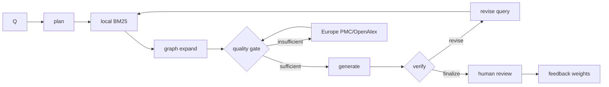

# 架构（v3.2.0）

## 总览

```
Web SPA / PWA / Android WebView
        │  HttpOnly Cookie 或 Bearer
        ▼
backend/app_v3.py :8010（默认 0.0.0.0）
   ├─ auth.py          账户 / 会话 / 限速
   ├─ lab.py           Model Lab：数据集 / 训练 / 不确定性 / EI / 回灌
   ├─ food.py          食品体系 → 候选 → 约束/指标/工艺/加工影响
   ├─ processing.py    加工条件 → 分子变化规则 + 证据 + 验证建议
   ├─ query_text.py    中英文别名扩展 / 术语 / 相关度
   ├─ datasources.py   实体规划 + 查询路由 + 在线源 + 缓存 + 验证链接
   ├─ composition.py   配料组成快照
   ├─ graph.py         证据图谱 / 来源表 / 生物设计图
   ├─ literature.py    本地 SQLite FTS5/BM25 文献检索
   ├─ compute.py       参数化 Vina → GROMACS → CP2K → 报告
   ├─ data.py          数据/路径/manifest
   ├─ engine.py        v1 生物设计（保留）
   ├─ report.py        v1 报告（保留）
   └─ training.py      v1 反馈/训练（保留）
        │
        ├─ data/*.json
        ├─ runtime/designs/<id>.json
        ├─ runtime/compute/<job_id>/
        ├─ runtime/lab.db + runtime/models/lab/
        ├─ runtime/tool_paths.json
        ├─ runtime/cache/
        └─ logs/bioforge.log

scripts/literature_pipeline.py
        │  Europe PMC REST（OPEN_ACCESS:Y）
        ▼
/media/h3c/Win11Pro X64/data/literature/
   ├─ bioforge_literature.db（papers / FTS5 / chunks / entities / edges）
   ├─ obsidian/<year>/*.md
   ├─ fulltext/<paper_id>.md
   ├─ xml/<paper_id>.xml
   └─ pdf/<paper_id>.pdf（可选）
```

v1 的 `backend/app.py:8000` 与 `runtime/jobs/` 独立保留；v2.1/v2.0 也各自保留端口和运行目录。

## 食品设计流

1. `food.design_food(query)` 解析体系、目标、工艺、pH、钠/糖降低比例、天然色素、生物活性词。
2. 10 个策略生成候选；硬过滤（体系、过敏原、pH、工艺、最大量）后按确定性评分选择配料，不使用随机数。
3. `composition.nutrients()` 读取 96 配料组成快照（35 个 USDA FDC SR Legacy 映射 + 61 个估算），质量加权计算营养。
4. 计算稳定性、感官、成本、营养、清洁标签、工艺适配、相互作用、pH、aw，并生成假设区间。
5. 生成 `constraint_report`、`metric_provenance`、`evidence_grade`、`recipe_changes`。
6. 生成配方、工艺、QC、控制点、储存、包装、法规、警告、决策链、`reasoning`、provenance。
7. 8 个候选按评分和多样性筛选；同输入可复现。
8. API 保存 `runtime/designs/<design_id>.json`。

## 证据流

- `datasources.search_all` 先分类实体，再选择来源；PubChem/UniProt 锚点优先，依赖项随后并发。
- 记录统一为 `source/id/title/url/license/retrieved_at/match_basis/relevance/data`。
- 化合物跨库链接必须由 UniChem InChIKey 验证；PDB 只由 UniProt xref 生成；MassBank link-only。
- FDC 失败回退版本化 SR Legacy 快照，状态 `degraded`。
- `graph.build_design_graph` 把设计、体系、策略、配料、约束、来源、文献和在线记录组织为节点/边。

## Model Lab 流

```
CSV/JSON → schema + SHA-256 → OOF 训练 → artifact + model card
        → EI 候选 → 导出/复核 → 湿实验回灌 → 追加行 → 可选重训 → 新版本
```

- `runtime/lab.db`：datasets / observations / models / runs。
- 模型 artifact：`runtime/models/lab/<model_id>.joblib` + `.card.json`。
- 合成/混合数据必须显式 opt-in；结果列默认排除并记录泄漏风险。
- 不确定性和区间未外部校准；候选不是实验结论。

## 计算流

1. `compute.start_job` 规范化参数，生成 `parameter_fingerprint`，创建 `runtime/compute/<id>/`。
2. `resolve` 映射蛋白/配体；`prepare` 下载 PDB、Meeko 准备受体/配体，并产出 `receptor.pdb` / `ligand.sdf`。
3. `_docking` 调 Vina；`_gromacs` 执行 `pdb2gmx → editconf → solvate → grompp em → mdrun em → grompp md → mdrun md`；`_cp2k` 执行 PBE 单点。
4. 每个阶段写 `job.json` 状态、`detail`、结果/错误；阶段失败相互隔离。
5. 超时向进程组发 SIGTERM，再 SIGKILL；避免子进程残留。
6. `_report` 生成 `report.md` / `report.html`，写入实际参数、指纹、错误和解释边界。
7. Web 每 5 秒轮询；artifact 通过受保护路径下载。
8. 工具路径由 `runtime/tool_paths.json` 管理；HADDOCK3 支持独立的蛋白-蛋白、蛋白-配体、蛋白-多糖任务，Vina/GROMACS/CP2K 仍走原机制管线。

## 文献流

1. `harvest` 用游标分页请求 Europe PMC，查询限定 `OPEN_ACCESS:Y`，支持多主题。
2. DOI 去重后写 `papers`，同步 `papers_fts`、`chunks`/`chunks_fts`、`entities`/`edges`。
3. 按许可尝试 PDF；Europe PMC PDF 端点被拦截时改用 `fullTextXML`，用 JATS 段落转 Markdown。
4. `export_obsidian` 按年份写带 frontmatter 的笔记。
5. `search` 使用 FTS5 BM25 + snippet；`stats` 输出规模与概念排行。

## 鉴权

- 账户：PBKDF2-HMAC-SHA256，240k iterations，随机 salt。
- 会话：HMAC-SHA256 签名，12h，HttpOnly/SameSite=Lax。
- 回退：`runtime/.token`，Bearer 或 X-API-Key。
- 限速：登录和数据库 40/min；设计 20/min；通用 120/min；Lab 写操作 40/min。
- 路径：job/design ID 正则 + resolve containment；结构代理只接受 4 字符 PDB ID。

## 前端

- 单页 SPA，无外部 CDN；系统字体。
- CSS 变量支持浅色/深色；桌面侧栏、移动底栏。
- 视图切换动画、横向候选 rail、触摸左右滑动切页。
- 登录 gate、服务器设置、设计、案例、在线证据、机制计算、3D 结构、Model Lab、设置。
- 3D 查看器为 canvas 2D 投影，不加载 WebGL/Three.js。
- Service Worker 缓存 `bioforge-v31-shell-2`。


## 3.3.0 RAG 编排



- 入口：`backend/knowledge_agent.py`；记录：`backend/rag_store.py`；接口：`/api/v3/rag/*`。
- 质量分/阈值、节点边标签、人工审核/回滚、DeepAgent 兼容性详见 `docs/KNOWLEDGE_RAG.md`。
- 本地库仍是 SQLite FTS5/BM25；外部只使用合法 OA 公共 API；回答必须人工审核。
