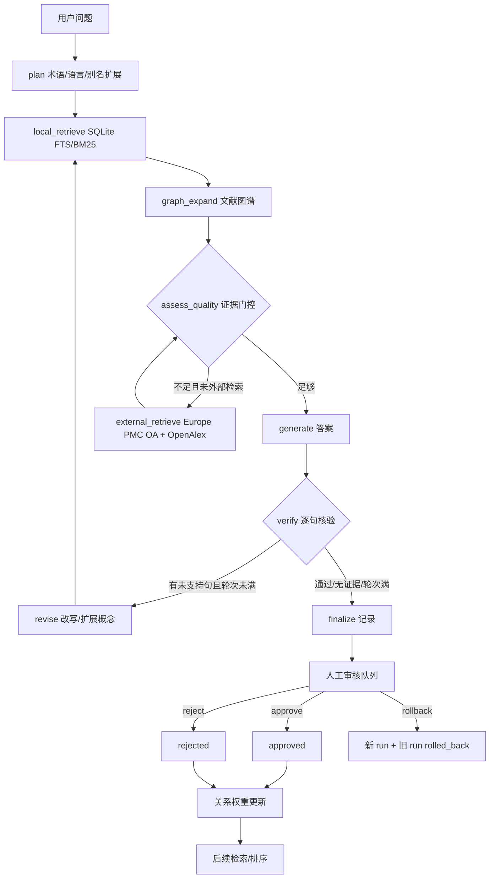

# BioForge Studio 3.3.0 · RAG / 知识图谱 / 人工监督报告

> 状态：3.3.0 代码路径已实现；本地 10,000 篇 OA 文献库和设计证据图谱是首选证据源。
> 外部 Europe PMC / OpenAlex 等合法 OA 公共 API 只在本地证据不足时使用；所有回答进入人工审核队列。
> 本文是 3.3.0 的关键逻辑链报告，不是系统综述、临床结论或监管文件。

## 1. 目标与边界

新问答不是“把问题直接丢给 27B 模型”。目标是：

1. 先检索本地 OA 文献库和本地知识图谱；
2. 判断证据数量、相关性、全文覆盖、图谱概念覆盖和可核验性；
3. 证据不足时，才调用 Europe PMC OA / OpenAlex 公共 API；
4. 用 LangGraph 执行“检索—扩展—判断—外部检索—生成—逐句核验—回查”的有状态循环；
5. 对弱证据明确警告，而不是用流畅语言掩盖不确定性；
6. 回答进入待审核队列，人工可以 approve / reject / rollback；
7. 用户反馈和人工审核结果写入关系权重，影响后续排序；
8. 保留完整运行记录：问题、路由、证据、图谱、引用、核验、警告、审核和反馈。

明确不做：

- 不编造论文、作者、DOI、数值、谱图或蛋白结构；
- 不使用 Sci-Hub、付费墙绕过、验证码规避或未授权批量下载；
- 不把关键词共现、工作流边、模型预测当作实验证据；
- 不把 Vina 打分、短 MD、QM 单点或本系统回答当作生产级自由能或监管安全结论；
- 不把 `deepagents` 说成已运行：生产主进程是 Python 3.10，`deepagents` 需要 Python ≥3.11，当前只提供可选独立 worker。

## 2. 与旧助手的关系

| 项目 | 3.2.2 旧助手 | 3.3.0 RAG |
|---|---|---|
| 回答来源 | 直接本地 Ollama，无强制检索 | 强制先查本地库/图谱；不足才外部 |
| 证据 | 无结构化 evidence/citation | `evidence[]` + `[E#]` + 来源链接 |
| 逻辑链 | 单一 prompt | LangGraph 状态图 + 路由 trace |
| 证据不足 | 依赖模型自述 | 规则评分 + 显式 warning |
| 人工监督 | 无 | pending review + approve/reject/rollback |
| 反馈学习 | 无 | feedback 更新关系权重 |
| 记录 | JSONL 历史 | SQLite `rag_runs` / `rag_reviews` / `rag_feedback` |

## 3. 总体架构



LangGraph 节点：

| 节点 | 作用 | 关键输出 |
|---|---|---|
| `plan` | 语言识别、别名展开、术语抽取 | `query_plan` |
| `local_retrieve` | 本地 SQLite BM25 | 本地 `evidence` |
| `graph_expand` | 论文→概念→共现边 | `graph.nodes/edges/concepts` |
| `assess_quality` | 规则评分和门控 | `quality`、warnings |
| `external_retrieve` | Europe PMC / OpenAlex OA | 外部 evidence、错误 |
| `generate` | LangChain prompt + Ollama，失败时模板 | `answer`、citations |
| `verify` | 句级引用/词项支持检查 | `verification` |
| `revise` | 用概念扩展问题并回查 | 新 query，iteration+1 |
| `finalize` | 落库并标记待审核 | 完整 run |

## 4. 本地优先与外部回退规则

### 4.1 本地检索

- 数据库：`/media/h3c/Win11Pro X64/data/literature/bioforge_literature.db`（可用 `BIOFORGE_LITERATURE_DB` 覆盖）。
- 规模：10,000 篇 OA 论文、25,062 chunks、48,544 实体、76,954 边；仅 12 篇有本地全文。
- 检索：`chunks_fts` + BM25，按 `query_text.relevance` 重排；保留 `snippet`、许可、DOI/PMCID、来源链接。
- 本地条目必须标为 `source=Local SQLite BM25`，不能和外部条目混为一谈。

### 4.2 质量门控

基础分：

```text
score = 0.44 * 前三本地相关性均值
      + 0.20 * min(1, 本地命中数 / 4)
      + 0.16 * min(1, 图谱概念数 / 6)
      + 0.12 * 查询词覆盖
      + 0.08 * min(1, 本地全文数 / 2)
```

外部证据加入后最多加 `+0.14`；只有外部证据时分数上限 `0.38`。

| 标签 | 条件 | 行为 |
|---|---|---|
| `strong` | ≥0.72 且前三相关性≥0.55 且本地≥3 | 仍需人工审核 |
| `moderate` | ≥0.45 | 正常回答 + 局限说明 |
| `weak` | ≥0.25 | 明确警告“偏弱/待验证” |
| `insufficient` | <0.25 或没有证据 | 不生成确定性结论 |

触发外部检索的条件：`score < 0.62` 或本地独立命中 `< 2`。外部检索启用时只查合法 OA 元数据；外部结果不自动升级为“已验证”。

### 4.3 外部公共 API

| 来源 | 用途 | 许可/注意 |
|---|---|---|
| Europe PMC REST | OA 题录/摘要/PMCID | 元数据 CC BY；摘要按出版方 |
| OpenAlex | OA 作品、来源、引用数 | 开放元数据；仍需回原文 |
| Crossref/Unpaywall/资源库 | 既有 DOI/全文入口解析 | 只解析，不绕过权限 |

外部结果放入 `runtime/rag/cache/`，缓存 24 小时；失败会写入 `warnings`，不会伪造成证据。

## 5. 知识图谱与标签

### 5.1 既有设计证据图谱（`backend/graph.py`）

节点类型：`design`、`food_system`、`protein`、`compound`、`biologic_target`、`candidate`、`strategy`、`ingredient`、`excipient`、`target`、`process`、`processing`、`processing_effect`、`mechanism`、`literature`、`data_source`、`online_source`、`online_record`、`constraint`。

主要边类型：`targets_system`、`selects_candidate`、`selects_strategy`、`uses`、`formulates_with`、`interaction`、`supported_by`、`mechanism_note`、`constraint`、`starts`、`next`、`completes`、`mentions`、`authored_by`、`published_in`、`contains`、`candidate_evidence`、`exact_inchikey`、`uniprot_pdb_xref`、`spectrum_reference`、`starts_process`、`next_process`、`predicts_change`。

`provenance` / `evidence_status`：

| 标签 | 含义 | 是否可作为实验证据 |
|---|---|---|
| `workflow` | 软件步骤/选择顺序 | 否 |
| `curated` | 本地策展先验/文献摘录 | 需回原文 |
| `verified` | 标识符级交叉验证 | 只证明实体一致，不证明功能 |
| `online` | 本次在线返回记录 | 未复现 |
| `reference` | 数据库参考谱/记录 | 否，需同条件实测 |
| `model` | 规则/模型预测 | 需实测验证 |
| `unknown` | 来源未知 | 否 |

### 5.2 RAG 覆盖层标签

RAG 运行记录中的图谱是**检索用的轻量覆盖层**，不替换设计证据图谱。

| 节点类型 | 例子 | 说明 |
|---|---|---|
| `query` | `query:current` | 当前用户问题 |
| `local_paper` | `local:epmc-...` | 本地 BM25 命中的论文 |
| `concept` | `concept:whey` | 论文标题/摘要关键词、作者关键词、MeSH 映射 |
| `external_paper` | `external:<hash>` | 外部 OA 元数据条目 |

| 边 | 中文标签 | 来源 | 状态 |
|---|---|---|---|
| `retrieves` | 本地检索命中 | BM25 | `retrieved` |
| `mentions` | 提及 | 标题/摘要/关键词 | `derived_from_metadata` |
| `co_occurs_with` | 共现 | 同论文内概念共现 | `hypothesis_needs_validation` |
| `routes_to_external` | 外部检索 | Europe PMC/OpenAlex | `external_needs_review` |

共现边只能产生“值得查”的假设，不能写成“A 导致 B”。报告和 UI 中均保留该限制。

## 6. 逐句核验

`verify` 对每条事实句检查：

1. 是否含有效 `[E#]` 引用；
2. 被引证据的标题/摘要/snippet 与被引句是否有足够词项重叠（规则阈值，非语义蕴含模型）；
3. 是否把局部/外部/共现/模型关系写成因果或临床结论；
4. 是否需要回查；未通过且轮次 <2 时进入 `revise`。

核验结果：

```json
{
  "status": "verified | needs_revision | insufficient",
  "support_rate": 0.0,
  "claims": [{"claim": "...", "citations": ["E1"], "status": "supported | needs_review"}],
  "rule": "有效引用 + 词项重叠；只能发现部分无依据表述"
}
```

这不是自然语言推理证明。人工审核仍是必需步骤。

## 7. 人工监督、回滚与反馈

### 7.1 审核状态

所有新回答初始 `pending_review`。审核人：

- `approve`：标记 `approved`，写入反馈 `+1`；
- `reject`：标记 `rejected`，写入反馈 `-1`；
- `rollback`：旧记录标记 `rolled_back`，以原问题 + 补充检索词创建新 run，保留 `prior_run_id`；
- `corrected_answer`：保存在 review 记录，不覆盖原始答案，保证审计可追溯。

审核人是本地操作者，不冒充外部同行评审。`reviewer` 字段和备注必须保留。

### 7.2 反馈学习

当前实现是**轻量奖励加权关系排序**，不是训练神经网络策略：

```text
w_new = clamp(w_old + 0.08 * (reward - w_old), -1, 1)
reward ∈ [-1, 1]
```

反馈写入 `rag_feedback`，并更新 `mentions` / `co_occurs_with` / `routes_to_external` 等关系键的权重，供后续运行展示和排序参考。没有足够样本时不得声称“模型已通过 RL 自我进化”。

### 7.3 存储

`runtime/rag/rag.sqlite3`（可用 `BIOFORGE_RAG_DB` 覆盖）：

| 表 | 内容 |
|---|---|
| `rag_runs` | 完整 JSON 记录、状态、质量分 |
| `rag_reviews` | approve/reject/rollback、审核人、备注、修订答案 |
| `rag_feedback` | reward、维度、备注 |
| `rag_relation_weights` | 关系键、权重、样本数、累计奖励 |

## 8. API

| 方法 | 路径 | 作用 |
|---|---|---|
| GET | `/api/v3/rag/status` | LangGraph/本地库/存储状态 |
| POST | `/api/v3/rag/ask` | 执行完整 RAG 链 |
| GET | `/api/v3/rag/runs/{id}` | 读取完整记录 |
| GET | `/api/v3/rag/reviews?status=pending_review` | 审核队列 |
| POST | `/api/v3/rag/runs/{id}/review` | approve/reject |
| POST | `/api/v3/rag/runs/{id}/rollback` | 回滚并重查 |
| POST | `/api/v3/rag/runs/{id}/feedback` | 奖励反馈 |
| POST | `/api/v3/rag/runs/{id}/deep-review` | 可选 DeepAgent 复核（需单独 Python ≥3.11 环境） |
| GET | `/api/v3/rag/weights` | 关系权重 |

请求示例：

```json
{"question":"槲皮素与乳清蛋白相互作用的证据强度如何？","max_iterations":2,"external":null}
```

## 9. 完整记录字段

每次 run 至少包含：

- `id`, `created_at`, `status`；
- `question`, `effective_question`；
- `answer`, `citations[]`；
- `quality{score,label,reasons,...}`；
- `route[]`（规划→本地→图谱→门控→外部→生成→核验→回查）；
- `trace[]`；
- `evidence[]`（本地/外部、相关性、许可、链接、snippet）；
- `graph{nodes,edges,concepts,notice}`；
- `verification{claims,support_rate,status}`；
- `warnings[]`；
- `human_review`；
- `limits{local_library,external_sources}`；
- `engine`, `deepagent` 状态。

## 10. DeepAgent 说明

`deepagents==0.7.32` 的元数据要求 Python `>=3.11`、LangChain `>=1.4.7`；当前主进程为 Python 3.10.20，无法安全混装。因此：

- 活跃编排器：LangGraph 0.2.76 + LangChain Core 0.3.76；
- 可选：`rag_worker/deep_review.py`，在单独 Python 3.11+ venv 中安装 `rag_worker/requirements.txt`，通过 `BIOFORGE_DEEPAGENT_PYTHON` 配置；
- 未配置时 API 明确返回 `available=false`，不伪造执行结果；
- DeepAgent reviewer 只接收一条 JSON 记录，禁止文件系统读写/受控环境执行；它不能替代人工审核。

## 11. 失败模式与限制

- 本地 10k OA 库不是全领域覆盖；无命中不等于没有研究。
- 多数记录只有题录/摘要；摘要中的机制描述仍需回原文。
- Europe PMC/OpenAlex 可能限流、字段缺失或摘要为空；会记录错误并继续。
- 规则核验不能证明因果、统计有效性或实验可重复性。
- 关键词共现和作者关键词是弱标签，不能当机制证据。
- Ollama 不可用、超时或模型不遵循引用格式时，退回确定性证据模板；模板仍保留引用和限制。
- 人工审核、回滚和反馈是流程控制，不是监管批准。

## 12. 验收

已覆盖的测试：

- 本地命中 → 质量分级 → 引用 → 逐句核验；
- 无证据 → `insufficient` + 显式警告；
- 本地不足 → 外部回退路由 → 外部材料标为待审核；
- approve / reject / feedback / rollback 状态与旧记录保留；
- LangGraph 状态图可编译并由 `langgraph` 执行。

人工验收仍需：真实原文抽查、许可核对、不同领域问题集、Ollama 长回答引用率、移动端审核操作。
